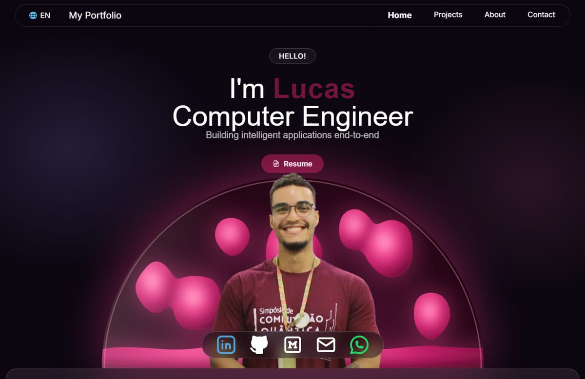

# Lucas Reis, portfolio

Personal portfolio of Lucas Reis, computer engineer: a single page with projects, an About section and a contact form, in 7 languages (EN, PT, ES, FR, JA, KO, ZH).



## Stack

Vite, React 19, Tailwind CSS 3, react-i18next, keen-slider, EmailJS.

## Run

```bash
npm install
npm run dev       # development
npm run build     # production build in dist/
npm run preview   # serve the build
```

## Configuration

Public values in `.env.production` (template in `.env.example`):

| Variable | Purpose |
|---|---|
| `VITE_SITE_URL` | Site address (link preview, canonical tag) |
| `VITE_RESUME_URL_EN` | Resume button link (English and other languages) |
| `VITE_RESUME_URL_PT` | Resume button link (Portuguese) |

Empty resume values make the button return to the main page.

## Deploy

Cloudflare Pages from `master`: build `npm run build`, output `dist`.

## Contributing

Structure, conventions and how to add a project or a language are in `AGENTS.md`.
